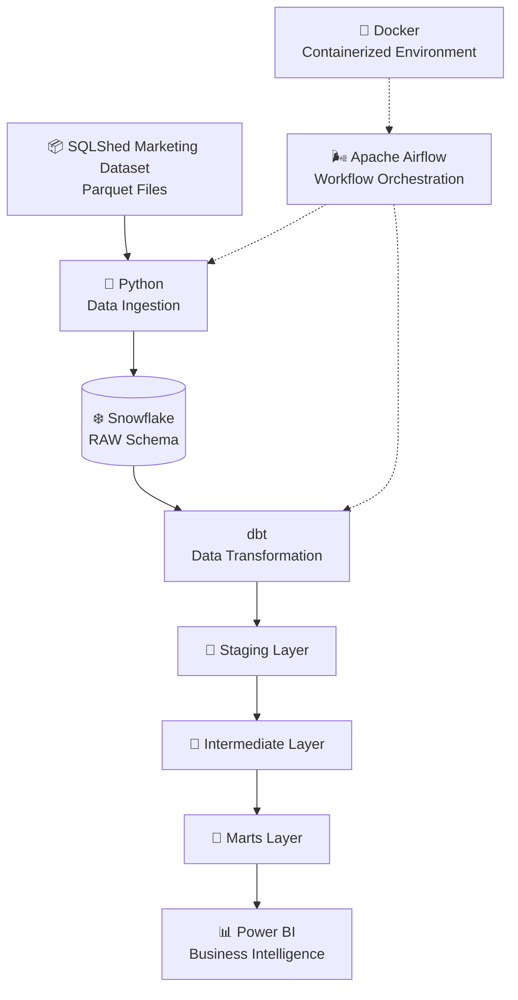

# 📊 Marketing Analytics — End-to-End ELT Data Pipeline

### Turning Raw Marketing Data into Actionable Business Insights

<p align="center">
  
  
  
</p>

<p align="center">
  
  
  
  
  
  
  
</p>

---

## 🚀 About the Project

This repository contains my **first hands-on End-to-End Data Engineering project**, built to explore how raw data can be transformed into reliable, structured, and analytics-ready information.

The project focuses on a marketing analytics use case. Digital marketing platforms generate large amounts of data about campaigns, advertising groups, customer interactions, clicks, impressions, spending, and conversions. However, raw data alone does not provide clear business insights.

The goal is to build an ELT pipeline that collects marketing data, stores it in a cloud data warehouse, transforms it into analytical models, and prepares it for business intelligence reporting.

Through this project, I am putting Data Engineering concepts into practice and learning how different tools work together in a real-world data workflow.

### 🎯 Project Objectives

- Build an end-to-end ELT workflow.
- Ingest multiple datasets using Python.
- Store raw data in Snowflake.
- Transform and organize data using dbt.
- Implement data quality tests.
- Orchestrate pipeline tasks with Apache Airflow.
- Containerize the environment using Docker.
- Prepare analytical datasets for Power BI dashboards.
- Understand how to design a dimensional data warehouse.

---

## 🏗️ Data Pipeline Architecture

The project follows an **ELT (Extract, Load, Transform)** architecture.

Instead of transforming all data before loading it into the warehouse, the pipeline first loads raw data into Snowflake and then performs transformations inside the warehouse using dbt.



### Pipeline Workflow

| Stage | Technology | Responsibility |
|---|---|---|
| Data Source | SQLShed | Provides the original marketing dataset |
| Extraction & Loading | Python | Reads Parquet files and loads data into Snowflake |
| Data Warehouse | Snowflake | Stores raw and transformed datasets |
| Transformation | dbt | Cleans, transforms, tests, and models data |
| Orchestration | Apache Airflow | Coordinates and schedules pipeline tasks |
| Environment | Docker | Runs the local containerized environment |
| Visualization | Power BI | Presents business metrics and insights |

---

## 📦 Dataset & Data Source

The project uses the **Marketing Campaigns Practice Dataset** provided by SQLShed.

🔗 **Original source:** [SQLShed — Marketing Campaigns Practice Dataset](https://sqlshed.com/practice-datasets/marketing-campaigns/)

The dataset contains five interconnected Parquet files representing different aspects of digital marketing performance.

| Dataset | Records | Description |
|---|---:|---|
| Channels | 9 | Marketing channel information |
| Campaigns | 600 | Campaign details and budgets |
| Ad Groups | 3,000 | Advertising group information |
| Daily Performance | 260,000 | Daily advertising performance metrics |
| Conversions | 40,000 | Individual conversion events |
| **Total** | **303,609** | **Records across all datasets** |

### Dataset Files

```text
data/
└── raw/
    └── marketing_campaigns1/
        ├── ad_groups.parquet
        ├── campaigns.parquet
        ├── channels.parquet
        ├── daily_performance.parquet
        ├── conversions.parquet
        └── schema.sql
```

### Data Attribution

The original dataset is provided by **SQLShed**. The engineering pipeline, ingestion workflow, warehouse modeling, transformations, tests, and analytics implementation are developed as part of this personal learning project.

---

## ⚙️ Technologies & Tools

<table>
  <tr>
    <td align="center" width="150">
      <br/>
      <b>Python</b>
    </td>
    <td>
      Used to read the source Parquet files, handle ingestion logic, and load datasets into Snowflake.
    </td>
  </tr>
  <tr>
    <td align="center">
      <br/>
      <b>Snowflake</b>
    </td>
    <td>
      Cloud data warehouse used to store raw data and serve as the foundation for analytical transformations.
    </td>
  </tr>
  <tr>
    <td align="center">
      <br/>
      <b>dbt</b>
    </td>
    <td>
      Used to transform raw data into structured staging, intermediate, and mart models, with schema and data quality tests.
    </td>
  </tr>
  <tr>
    <td align="center">
      <br/>
      <b>Apache Airflow</b>
    </td>
    <td>
      Used to define and orchestrate pipeline workflows and manage dependencies between ingestion, transformation, and testing tasks.
    </td>
  </tr>
  <tr>
    <td align="center">
      <br/>
      <b>Docker</b>
    </td>
    <td>
      Provides a containerized environment for running the Airflow services and project components.
    </td>
  </tr>
  <tr>
    <td align="center">
      <br/>
      <b>Power BI</b>
    </td>
    <td>
      Used to connect to the analytical models and build interactive marketing performance dashboards.
    </td>
  </tr>
  <tr>
    <td align="center">
      <br/>
      <b>Git & GitHub</b>
    </td>
    <td>
      Used for version control, source code management, and project documentation.
    </td>
  </tr>
</table>

### Languages & Data Formats

- **Python** — ingestion and data handling.
- **SQL** — warehouse queries and dbt transformations.
- **YAML** — dbt configuration, model properties, and tests.
- **DAX** — Power BI analytical measures.
- **Parquet** — columnar source data format.

---

## 🧱 Data Warehouse Design

The Snowflake warehouse follows a layered architecture to separate raw data from analytical models.

### 1. Raw Layer

Database: `MARKETING_ANALYTICS_DB`

Schema: `RAW`

Contains the original datasets loaded from Parquet files.

| Raw Table |
|---|
| `RAW_MC_CHANNELS` |
| `RAW_MC_CAMPAIGNS` |
| `RAW_MC_AD_GROUPS` |
| `RAW_MC_DAILY_PERFORMANCE` |
| `RAW_MC_CONVERSIONS` |

### 2. Transformation Layers — dbt

The dbt project organizes transformations into three layers:

**🥉 Staging — `RAW_STAGING`**

- Standardizes column names and data types.
- Performs initial cleaning.
- Creates one staging model per source dataset.

**🥈 Intermediate — `RAW_INTERMEDIATE`**

- Combines related datasets.
- Applies business logic.
- Prepares reusable transformation models.

**🥇 Marts — `RAW_MARTS`**

Creates analytics-ready dimensions and fact tables.

#### Dimension Tables

| Model | Rows |
|---|---:|
| `DIM_CHANNELS` | 9 |
| `DIM_CAMPAIGNS` | 600 |
| `DIM_AD_GROUPS` | 3,000 |
| `DIM_DATE` | 731 |

#### Fact Tables

| Model | Rows |
|---|---:|
| `FCT_DAILY_PERFORMANCE` | 260,000 |
| `FCT_CONVERSION_ATTRIBUTION` | 40,000 |

The final models follow a dimensional modeling approach, separating descriptive dimensions from measurable business events.

---

## 🧪 Data Quality & Testing

Data quality is an important part of building a reliable analytics pipeline.

I implemented dbt tests to validate the transformed data, including checks such as:

- Unique identifiers.
- Not-null constraints.
- Referential integrity.
- Valid relationships between models.

### Current Test Results

| Layer | Tests Passed |
|---|---:|
| Staging | 18 |
| Intermediate | 14 |
| Marts | 23 |
| **Total** | **55** |

<details>
<summary><b>View the dbt test commands</b></summary>

```bash
dbt test
```

To run a specific model:

```bash
dbt run --select stg_mc_campaigns
```

To test a specific model:

```bash
dbt test --select stg_mc_campaigns
```

</details>

---

## 📊 Business Intelligence & Analytics

The final objective is to turn the modeled data into meaningful marketing insights using Power BI.

The analytical layer supports questions such as:

- Which marketing channels generate the most conversions?
- Which campaigns produce the highest return on advertising spend?
- How do impressions, clicks, and spending change over time?
- Which ad groups generate spending without conversions?
- How do first-touch and last-touch attribution differ?
- Which campaigns exceed their planned budgets?

### Planned Dashboard Areas

| Dashboard | Focus |
|---|---|
| Marketing Overview | Campaign distribution, channel performance, conversions, and revenue |
| Performance & Optimization | CTR, CPC, ROAS, spending, and campaign performance |
| Advanced Marketing Intelligence | Attribution analysis, conversion efficiency, and budget monitoring |

*Power BI dashboards are under development.*

---

## 📐 Key Marketing Metrics

The project uses several marketing performance indicators.

| Metric | Formula | Purpose |
|---|---|---|
| CTR | Clicks / Impressions | Measures how often impressions generate clicks |
| CPC | Spend / Clicks | Measures the average cost per click |
| Conversion Rate | Conversions / Clicks | Measures how effectively clicks generate conversions |
| ROAS | Revenue / Spend | Measures revenue generated per unit of advertising spend |

These metrics are calculated from aggregated data at the appropriate level to avoid misleading results.

---

## 📁 Repository Structure

```text
Marketing-Analytics-End-to-End-ELT-Data-Pipeline/
│
├── airflow/
│   ├── dags/
│   │   └── marketing_analytics_dag.py
│   ├── docker-compose.yaml
│   └── ...
│
├── data/
│   └── raw/
│       └── marketing_campaigns1/
│
├── ingestion/
│   └── ...
│
├── marketing_analytics_dbt/
│   ├── models/
│   │   ├── staging/
│   │   ├── intermediate/
│   │   └── marts/
│   ├── tests/
│   └── dbt_project.yml
│
├── .env.example
├── .gitignore
└── README.md
```

*Some local configuration files and raw data are intentionally excluded from GitHub.*


*Note: Complete ingestion and orchestration setup is still being aligned with the final Parquet-based workflow. The commands above assume the local environment and Snowflake configuration have been prepared.*

---

## 🎓 What I'm Learning Through This Project

This project is more than a technical implementation. It is an opportunity to understand how Data Engineering concepts connect in practice.

Some of the main concepts I am exploring:

- ELT architecture and modern data workflows.
- Data ingestion from columnar file formats.
- Cloud data warehousing with Snowflake.
- Data modeling and dimensional schemas.
- Transformation workflows using dbt.
- Data quality and automated testing.
- Workflow orchestration with Apache Airflow.
- Containerization with Docker.
- Analytical modeling and business intelligence.
- Version control and project documentation.

As my first practical end-to-end Data Engineering project, it also helps me identify what I understand, what I need to improve, and how to approach larger data systems.

---

## 🗺️ Project Roadmap

- [x] Explore and understand the marketing dataset.
- [x] Load raw Parquet datasets into Snowflake.
- [x] Build dbt staging models.
- [x] Develop intermediate transformation models.
- [x] Create dimensional and fact models.
- [x] Implement dbt data quality tests.
- [x] Configure a Docker-based Airflow environment.
- [x] Publish the project on GitHub.
- [ ] Finalize Parquet ingestion integration with Airflow.
- [ ] Complete end-to-end DAG orchestration.
- [ ] Complete Power BI dashboards.
- [ ] Document pipeline execution and final results.

---

